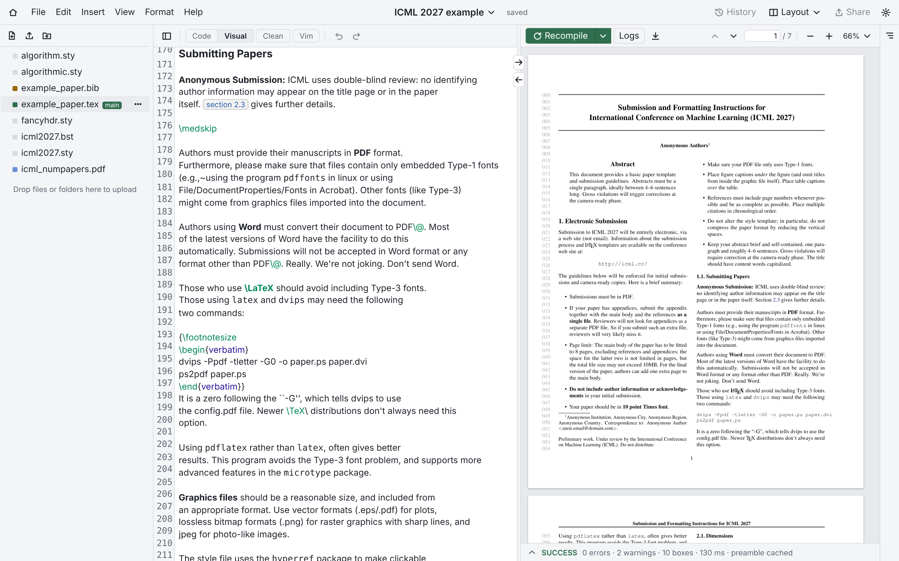

# MyLeaf

An open-source, self-hostable collaborative LaTeX editor.

> **Early development.** MyLeaf runs as a single-user editor today;
> collaboration (real-time sync, comments, suggestions) is on the roadmap.



## Features

- **Editor**: CodeMirror with LaTeX autocomplete, an optional vim mode, and
  three modes: Code, Visual (LaTeX rendered in place) and Clean.
- **PDF viewer**: PDF.js with SyncTeX navigation between source and PDF, and
  a document outline panel.
- **Compiling**: TeX Live through `latexmk`, with optional live preview
  (TeXpresso or a patched pdfTeX); unchanged images are reused between
  compiles, and a draft mode shows images as boxes for faster compiles.
- **Projects**: file tree, drag-and-drop upload and `.zip` import.
- **Appearance**: light and dark themes, editor font and layout settings.

"MyLeaf" (and the `@myleaf/*` package scope) is a working name.

Licensed under [AGPL-3.0](LICENSE). Design decisions: [docs/adr](docs/adr/README.md).

## Development

Requirements:

- Node.js 22 (see `.nvmrc`) and corepack (bundled with Node.js).
- TeX Live with `latexmk` and `synctex` on `PATH`, for compiling.

```bash
corepack enable
pnpm install
pnpm dev          # server on 127.0.0.1:3000, web app on http://localhost:5173,
                  # with the sample project "ICML 2027 example" (samples/icml2027)
pnpm check        # format, lint, typecheck, test, build (as CI)
pnpm e2e          # end-to-end browser test (after `pnpm build`)
pnpm bench        # compile-time benchmark (ADR 0011)
pnpm bench:images # compile times with the image options (ADR 0011)
```

Server configuration (environment variables):

| Variable                    | Default     | Purpose                                                                                            |
| --------------------------- | ----------- | -------------------------------------------------------------------------------------------------- |
| `HOST`                      | `127.0.0.1` | Address to listen on                                                                               |
| `PORT`                      | `3000`      | Port to listen on                                                                                  |
| `MYLEAF_DATA_DIR`           | `./data`    | Project files (`projects/`) and builds (`builds/`)                                                 |
| `MYLEAF_LIVE_ENGINE`        | `texpresso` | Live preview engine: `texpresso` or `pdftex` (alias `pdflatex`)                                    |
| `MYLEAF_TEXPRESSO`          | (unset)     | Patched TeXpresso binary for live preview; `off` disables it (see below)                           |
| `MYLEAF_PDFTEX`             | (unset)     | Patched pdfTeX binary, with `MYLEAF_LIVE_ENGINE=pdftex`                                            |
| `MYLEAF_LIVE_MAX_SESSIONS`  | `4`         | Live previews open at once (~250 MB each)                                                          |
| `MYLEAF_LIVE_IDLE_MINUTES`  | `10`        | Inactivity before a live preview is closed                                                         |
| `MYLEAF_LIVE_MAX_SNAPSHOTS` | `32`        | Most pdfTeX live-preview snapshots per session (~3 MB each; `0`: none)                             |
| `MYLEAF_LIVE_TAIL_DELAY_MS` | `300`       | pdfTeX live preview: pages past the visible ones wait until typing pauses this long (`0`: no wait) |
| `MYLEAF_LIVE_TRACE`         | (unset)     | File to append a trace of pdfTeX live preview to (edits, runs, pdfTeX messages, pages)             |
| `MYLEAF_SAMPLE_PROJECT`     | (unset)     | Folder to create the sample project from if missing (`pnpm dev` sets it)                           |

Live preview (optional, ADR 0012) needs the patched TeXpresso: install the
packages listed in `vendor/texpresso/README.md` (Ubuntu and macOS; only
Linux is tested in CI), then

```bash
vendor/texpresso/build.sh
```

```bash
pnpm dev
```

The server uses `vendor/texpresso/build/bin/texpresso` when it exists, or
the binary `MYLEAF_TEXPRESSO` points to (`MYLEAF_TEXPRESSO=off` turns live
preview off). Without a usable binary it runs with live preview disabled and
says why in its startup log.

With `MYLEAF_LIVE_ENGINE=pdftex`, live preview runs on the patched pdfTeX
instead (level 2 in `docs/spikes/pdflatex-live-preview.md`): its pages are
pdfLaTeX's own output. Build it with `vendor/pdftex/build.sh` (dependencies
in `vendor/pdftex/README.md`); it also needs TeX Live. Its pages are sent
as one-page PDFs and drawn in the browser by MuPDF (WebAssembly), with
selectable text and SyncTeX navigation (`synctex` on `PATH`).
The server uses `vendor/pdftex/build/bin/pdftex`, or the binary
`MYLEAF_PDFTEX` points to.

There is no authentication yet, and compilation is hardened but not
sandboxed (see [ADR 0010](docs/adr/0010-projects-storage-and-compile-service.md)).
Only expose the server to people you trust.

| Path                       | Layer   | Purpose                                                    |
| -------------------------- | ------- | ---------------------------------------------------------- |
| `packages/doc-model`       | Domain  | Ids, actors, `TextDocument` port (text, marks, anchors)    |
| `packages/annotations`     | Domain  | Comment threads, suggestions (track changes), projections  |
| `packages/project`         | Domain  | Project paths and files, `ProjectStore` port               |
| `packages/compile`         | Domain  | `CompileBackend` port, SyncTeX types, log diagnostics      |
| `packages/api`             | Domain  | HTTP routes and DTO types shared by server and web         |
| `packages/sync-yjs`        | Adapter | `TextDocument` on Yjs                                      |
| `packages/storage-fs`      | Adapter | `ProjectStore` on the filesystem                           |
| `packages/compile-texlive` | Adapter | `CompileBackend` on latexmk + synctex                      |
| `packages/live-preview`    | Domain  | `LivePreviewBackend` port                                  |
| `packages/live-texpresso`  | Adapter | `LivePreviewBackend` on patched TeXpresso                  |
| `packages/live-pdftex`     | Adapter | `LivePreviewBackend` on patched pdfTeX (level 2)           |
| `packages/latex-syntax`    | Domain  | Structural LaTeX parser with source offsets                |
| `packages/editor-visual`   | Adapter | Visual mode: CodeMirror extension rendering LaTeX in place |
| `packages/testing`         | Testing | Port contract suites and in-memory test doubles            |
| `apps/server`              | App     | Fastify HTTP server                                        |
| `apps/web`                 | App     | React web client (CodeMirror, PDF.js)                      |
| `samples/icml2027`         | Sample  | Third-party paper loaded by `pnpm dev` for manual testing  |

Layering rules: [ADR 0009](docs/adr/0009-module-boundaries.md).

## Goals (by priority)

1. **Collaboration**: anchored comment threads with @mentions, Google-Docs-style
   suggestions (track changes) with review and resolution.
2. **AI agents as collaborators**: agents comment and suggest through the same
   API as people, exposed over MCP.
3. **Visual modes**: a readable source mode, and a clean mode that hides
   comments and renders LaTeX inline.
4. **Fast compilation**: near-instant preview.
5. **Tables**: spreadsheet-style editing and CSV import.
6. **File and component navigation** for large projects.
7. **Configurable behavior** (e.g. auto-compile triggers).

## Non-goals

- Operating a hosted service. The project provides what is needed for local,
  self-, and third-party hosting.

## Roadmap

| Phase | Scope                                                                                                                                                                                                                                                                                                                   |
| ----- | ----------------------------------------------------------------------------------------------------------------------------------------------------------------------------------------------------------------------------------------------------------------------------------------------------------------------- |
| 0     | Repository skeleton, tooling, CI, data model for documents, anchors and annotations                                                                                                                                                                                                                                     |
| 1     | Single user: files, editor, compile (L1), PDF viewer, SyncTeX navigation                                                                                                                                                                                                                                                |
| 2     | Multi-user: auth, real-time sync, presence                                                                                                                                                                                                                                                                              |
| 3     | Comments, threads, suggestions                                                                                                                                                                                                                                                                                          |
| 4     | AI actors and MCP server                                                                                                                                                                                                                                                                                                |
| 5     | Visual modes, instant in-editor rendering (L2): visual mode in progress (ADR 0016: headings, text styles, comments, preamble, math, lists, reference chips with numbers from the last compile, figures done; PDF figures next)                                                                                          |
| 6     | Tables, navigation, configuration                                                                                                                                                                                                                                                                                       |
| —     | Configurable from the UI: engine choice, compile settings, resource limits (now environment variables)                                                                                                                                                                                                                  |
| —     | Live preview (L3) with TeXpresso: done, with continuous scroll, references and citations (ADR 0012, 0014)                                                                                                                                                                                                               |
| —     | Live tab in the PDF toolbar, always clickable when live preview is available (not on by default)                                                                                                                                                                                                                        |
| —     | Live preview with pdfLaTeX: TeXpresso's technique on pdfTeX. First a 1–2 day spike (driver with another engine, I/O and snapshot hooks in pdfTeX, page rendering); then a pdfTeX kept warm after the preamble; then full snapshots. Weeks to months; spike analysis done, paused (docs/spikes/pdflatex-live-preview.md) |
| —     | Faster pdfLaTeX compiles: one pdfLaTeX pass without latexmk while auto-compiling, done (ADR 0011: text edit ~400 → ~300 ms, heading edit ~700 → ~300 ms). Next: re-render only changed pages; stopping after the visible page deferred (truncated PDF, small gain; ADR 0011)                                            |
| —     | Desktop app                                                                                                                                                                                                                                                                                                             |
